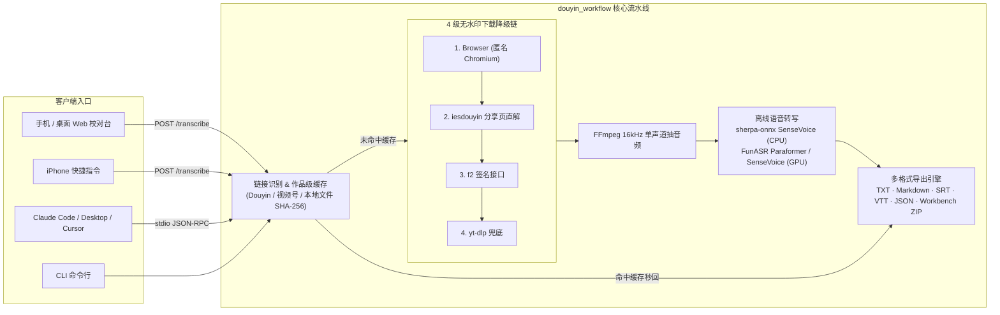

# Douyin Transcript Public (`douyin-transcript-public`)

<p align="center">
  <a href="LICENSE"></a>
  <a href="pyproject.toml"></a>
  <a href="douyin_workflow/mcp_server.py"></a>
  <a href="Dockerfile"></a>
  <a href="README_EN.md"></a>
</p>

<p align="center">
  <b>免密码抖音 / 微信视频号 / 本地音视频离线语音转写、无水印下载与 MCP Server</b><br>
  4 级降级下载链（Chromium → iesdouyin → f2 → yt-dlp） · SenseVoice / Paraformer 离线 ASR · 多格式导出（TXT / Markdown / SRT / VTT / JSON） · 手机 Web 校对台
</p>

<p align="center">
  <b>简体中文</b> | <a href="README_EN.md">English</a>
</p>

---

独立部署的抖音、微信视频号链接转文字与无水印素材下载服务。抖音链接默认免密码；微信视频号链接使用单独的访问密码和元宝 Web 登录态。转写完成后可一键下载 **TXT、Markdown（含 YAML Frontmatter）、SRT/VTT 字幕、原视频** 以及 **创作工作台素材包（Creator Workbench ZIP）**。

## 核心特性

- **4 级自动降级下载链**：按 `匿名 Chromium → iesdouyin 分享页解析 → f2 → yt-dlp` 顺序自动切换，单点风控或页面改版不中断服务，内置无水印流提取与多 CDN 候选回退。
- **双引擎离线中文 ASR**：
  - **轻量纯 CPU 模式（`sherpa-sensevoice`）**：基于 `sherpa-onnx` + SenseVoice int8（约 230 MB，无需 PyTorch/GPU），支持按静音能量谷值智能切分长音频，低配云服务器即可流畅运行。
  - **GPU / 高精度模式（`SenseVoiceSmall` / `paraformer-zh`）**：基于 FunASR + FSMN-VAD + CT-Punc，支持 GPU 加速。
- **多格式导出（`TXT` / `Markdown` / `SRT` / `VTT` / `JSON`）**：
  - **Markdown（`.md`）**：自动生成 YAML Frontmatter（`title`, `author`, `aweme_id`, `duration_s`, `source_url`, `sha256`）与分段正文，直接拖入 Obsidian / Notion 或喂给 LLM。
  - **字幕文件（`.srt` / `.vtt`）**：按分句与时长自动对齐时间戳，可直接导入剪映、Premiere、Final Cut Pro、DaVinci Resolve。
  - **创作工作台素材包（Creator Workbench ZIP）**：打包无水印原视频、校对后逐字稿与带 SHA-256 校验及版权状态的 `manifest.json`。
- **原生 MCP Server**：一行命令接入 **Claude Desktop**、**Claude Code**、**Cursor**，在对话框内粘贴抖音分享口令即可直接拉取逐字稿。
- **移动端 Web 校对台 & iOS 快捷指令兼容**：单页响应式设计（支持深色模式），支持在线编辑修正专有名词、一键复制深挖/成片提示词、长任务轮询去重与作品级落盘缓存。
- **生产级安全与容量边界**：动态 Nonce CSP、防 iframe、64 KiB 请求体上限、原视频 24 小时 TTL 与 2 GiB 容量配额自动清理、Nginx 按 IP 限流。

---

## 系统架构



---

## 与同类工具对比

| 能力维度 | 常见抖音下载 API | 在线云端音视频转写工具 | `douyin-transcript-public`（本项目） |
| :--- | :---: | :---: | :---: |
| 无水印视频下载 | ✅ 单一解析接口 | ❌ 仅输出文字 | ✅ **4 级自动降级链**（Chromium / iesdouyin / f2 / yt-dlp） |
| 离线本地 ASR 转写 | ❌ 不含语音转写 | ❌ 需按分钟付费 / 上传云端 | ✅ **本地 SenseVoice int8 (纯 CPU) / FunASR (GPU)** |
| MCP Server 集成 | ❌ | ❌ | ✅ **原生支持 Claude Desktop / Claude Code / Cursor** |
| 导出格式 | MP4 | TXT / SRT | ✅ **TXT / Markdown (YAML) / SRT / VTT / JSON / 工作台素材包 ZIP** |
| 微信视频号 & 本地音视频 | ❌ | ⚠️ 仅支持本地上传 | ✅ **支持视频号链接解析 + 本地文件按 SHA-256 缓存转写** |
| 公网自托管安全防线 | ⚠️ 多数无鉴权/配额控制 | — | ✅ **Nonce CSP + 24h 视频配额清理 + 抖音免密/视频号独立鉴权** |

---

## 快速开始

### 方式一：Docker Compose 一键部署（推荐）

内置 Python 3.12、FFmpeg、匿名 Chromium 与 `sherpa-onnx` 运行时：

```bash
git clone https://github.com/ychenfen/douyin-transcript-public.git
cd douyin-transcript-public

# 将 SenseVoice int8 模型文件（model.int8.onnx 与 tokens.txt）放入 ./data/models/sensevoice/
mkdir -p data/models/sensevoice data/items data/secrets

# 启动服务（默认监听 http://localhost:8766）
docker compose up -d
```

### 方式二：本地 Python / `uv` 安装

需要 Python 3.10+ 及系统已安装 `ffmpeg`（macOS：`brew install ffmpeg`；Ubuntu：`apt install ffmpeg`）：

```bash
python3.12 -m venv .venv
# 轻量 CPU 模式（sherpa-onnx + SenseVoice int8）：
.venv/bin/pip install -e ".[lite,f2,browser,dev]"

# 或 FunASR 模式（支持 GPU / PyTorch）：
# .venv/bin/pip install -e ".[asr,f2,browser,dev]"
```

启动免密码开发服务：

```bash
DOUYIN_REQUIRE_AUTH=0 .venv/bin/python -m douyin_workflow serve --host 127.0.0.1 --port 8766
```

开启全站口令保护：

```bash
DOUYIN_REQUIRE_AUTH=1 DOUYIN_SERVER_TOKEN='<从钥匙串或环境变量注入>' \
  .venv/bin/python -m douyin_workflow serve --host 127.0.0.1 --port 8766
```

浏览器口令仅写入 `sessionStorage`，关闭标签页后自动失效。生产环境可保持抖音免密码，同时只对微信视频号链接及其视频/素材包下载要求口令。

---

## MCP Server 接入指南（Claude / Cursor）

本项目内置标准 stdio MCP 服务（[`douyin_workflow/mcp_server.py`](douyin_workflow/mcp_server.py)），所有日志与模型加载输出均严格重定向至 `stderr`，保证 JSON-RPC 通信纯净。

### 1. Claude Code 一行命令添加

```bash
claude mcp add douyin -- /path/to/douyin-transcript-public/.venv/bin/python -m douyin_workflow.mcp_server
```

### 2. Claude Desktop / Cursor 配置文件

在 `claude_desktop_config.json` 或 Cursor 的 `.cursor/mcp.json` 中添加：

```json
{
  "mcpServers": {
    "douyin-transcript": {
      "command": "/path/to/douyin-transcript-public/.venv/bin/python",
      "args": ["-m", "douyin_workflow.mcp_server"],
      "env": {
        "DOUYIN_DATA_DIR": "/Users/yourname/douyin_workflow_data",
        "DOUYIN_ASR_MODEL": "sherpa-sensevoice",
        "DOUYIN_SHERPA_MODEL_DIR": "/Users/yourname/dy2text-public/models/sensevoice",
        "DOUYIN_BACKENDS": "browser,iesdouyin,f2,ytdlp"
      }
    }
  }
}
```

### 暴露的 MCP 工具列表

| MCP 工具名 | 参数 | 说明 |
| :--- | :--- | :--- |
| `douyin_to_text` | `share_text: str, force: bool = False` | 直接粘贴抖音 App 分享口令或短链，返回标题、作者、时长与完整逐字稿（自动命中本地缓存）。 |
| `video_file_to_text` | `path: str, title: str \| None = None, force: bool = False` | 将本机任意音视频文件（录屏、视频号下载文件等）转写为逐字稿，按文件内容 SHA-256 缓存。 |
| `wechat_link_to_text` | `share_text: str, force: bool = False` | 解析并转写微信视频号 `weixin.qq.com/sph/...` 分享链接（需环境变量注入 `WECHAT_YUANBAO_COOKIE`）。 |
| `douyin_list_local` | `limit: int = 20` | 列出本地素材库最近处理过的作品元数据（`aweme_id`、标题、作者、时长、创建时间）。 |

---

## 命令行与多格式导出（CLI & HTTP API）

### CLI 直接转写并指定导出格式

支持 `--format {txt,json,md,srt,vtt}`：

```bash
# 1. 转写抖音口令并直接输出带 YAML Frontmatter 的 Markdown
.venv/bin/python -m douyin_workflow run "7.43 复制打开抖音，看看 https://v.douyin.com/xxxx/" --format md

# 2. 转写本地视频并生成 SRT 字幕
.venv/bin/python -m douyin_workflow file ~/Downloads/demo.mp4 --title "技术分享" --format srt

# 3. 将已缓存的作品导出为 SRT / VTT / Markdown 文件
.venv/bin/python -m douyin_workflow export 7372484719365098803 --format srt -o subtitle.srt
.venv/bin/python -m douyin_workflow export 7372484719365098803 --format md -o note.md

# 4. 查看本地已处理的素材列表
.venv/bin/python -m douyin_workflow list --limit 20

# 5. 检查各下载后端健康状态（可配合 DOUYIN_ALERT_WEBHOOK 推送告警）
DOUYIN_HEALTH_URLS="https://www.douyin.com/video/7372484719365098803" \
  .venv/bin/python -m douyin_workflow healthcheck
```

### HTTP 接口一览

| 方法与路径 | 说明 |
| :--- | :--- |
| `GET /` | 手机/桌面响应式 Web 素材校对台（含动态 Nonce CSP） |
| `GET /health` | 健康检查，返回 `{"ok": true}` |
| `POST /transcribe` | 提交抖音/视频号分享文本（JSON `{"text": "..."}` 或纯文本），返回 `status: done \| running \| error` |
| `GET /items/<id>/transcript.md` | 下载 YAML Frontmatter + 结构化段落的 Markdown 笔记 |
| `GET /items/<id>/transcript.srt` | 下载标准 SubRip (`.srt`) 字幕文件 |
| `GET /items/<id>/transcript.vtt` | 下载标准 WebVTT (`.vtt`) 字幕文件 |
| `GET /items/<id>/transcript.txt` | 下载纯文本逐字稿 |
| `GET /items/<id>/transcript.json` | 下载完整结构化 JSON 元数据与逐字稿 |
| `GET /media/<id>/video` | 下载保留期内的无水印原视频（`.mp4`） |
| `POST /bundle` | 生成并下载包含原视频、校对稿与 `manifest.json`（含 SHA-256）的创作工作台素材包 ZIP |

---

## 视频号与本地视频转写

### 分享链接直接转写

视频号的公开分享页只提供标题、作者和封面，不提供视频流。本项目支持使用已登录的腾讯元宝 Web 会话取得短期播放凭证，再下载、抽音频并转写：

```bash
WECHAT_YUANBAO_COOKIE='<从钥匙串或受限环境文件注入>' \
  .venv/bin/python -m douyin_workflow run 'https://weixin.qq.com/sph/...'
```

- 登录 Cookie 只从 `WECHAT_YUANBAO_COOKIE` 注入，绝不写入代码、日志、素材元数据或接口响应。
- 元宝 Cookie 通常约一个月失效；失效后重新登录并更新配置。服务器环境文件权限必须设为 `0600`。
- 公网页面即使设置 `DOUYIN_REQUIRE_AUTH=0`，微信链接仍由 `WECHAT_REQUIRE_AUTH=1` 单独保护，访问密码复用 `DOUYIN_SERVER_TOKEN`。

### 本地文件转写（备用）

当没有在线链接或只有本地录屏时，可直接对本地文件转写：

1. 视频号本地下载可使用开源工具 [wx_channels_download](https://github.com/ltaoo/wx_channels_download)（Windows / macOS），或直接使用录屏文件。
2. 运行本地文件转写：

```bash
.venv/bin/python -m douyin_workflow file ~/Downloads/某视频.mp4 --title "技术架构复盘"
```

- 支持 `ffmpeg` 能读取的任何视频或音频格式，原文件只读不动。
- 按文件内容 SHA-256 缓存，结果写入 `<数据目录>/file-<哈希前16位>/`，和抖音作品一起出现在 `list` 里。

---

## 生产环境部署（Linux systemd / Nginx & macOS LaunchAgent）

### Linux 独立生产部署

默认生产标识示例：

| 项目 | 值 |
|---|---|
| 服务器目录 | `/home/ubuntu/dy2text-public` |
| 应用服务 | `dy2text-public.service` |
| Cookie 定时器 | `dy2text-public-cookie-refresh.timer` |
| 后端地址 | `127.0.0.1:8766` |
| 公网入口 | `https://video.example.com/dy/` |

部署模板位于 [`deploy/linux/`](deploy/linux/)：

- [`dy2text.env.example`](deploy/linux/dy2text.env.example)：环境变量与免密码开关模板（生产环境请 `chmod 600`）
- [`dy2text-public.service`](deploy/linux/dy2text-public.service)：systemd 应用服务（含 `ProtectSystem=strict`、`NoNewPrivileges=true` 等安全加固）
- [`dy2text-public-cookie-refresh.service`](deploy/linux/dy2text-public-cookie-refresh.service) / [`.timer`](deploy/linux/dy2text-public-cookie-refresh.timer)：定时通过无头浏览器刷新匿名抖音 Cookie
- [`nginx-rate-limit.conf`](deploy/linux/nginx-rate-limit.conf)：安装到 `/etc/nginx/conf.d/` 的全局 IP 限流区
- [`nginx-location.conf`](deploy/linux/nginx-location.conf)：站点内的 `/dy/` 反向代理配置

### macOS 登录自启服务（LaunchAgent）

在 macOS 上可通过脚本一键注册为后台 LaunchAgent，配合 Tailscale 即可在手机快捷指令中随时调用：

```bash
bash deploy/macos/install.sh
```

---

## 安全与容量边界

免密码模式并不等于无防线裸奔。公网部署默认保留以下边界：

- **Nginx 速率与并发限制**：每 IP 30 次/分钟（突发 15 次），每 IP 最多 3 个并发连接。
- **单工作线程队列**：服务端按作品 ID 去重，转写任务串行执行，防止并发打满 CPU / 显存。
- **请求体大小限制**：HTTP 请求体上限 64 KiB（拒绝超大 Payload 攻击）。
- **视频自动过期清理**：保留原视频默认 **24 小时过期（`DOUYIN_VIDEO_TTL_HOURS=24`）** 且 **总容量上限 2 GiB（`DOUYIN_VIDEO_MAX_GB=2`）**；清理时仅删除 `video.*`，永久保留逐字稿与元数据。
- **隐私与凭证隔离**：抖音下载不读取个人浏览器配置，Cookie 刷新仅使用匿名临时会话；签名播放链接在错误日志中自动脱敏。
- **版权合规提示**：下载素材不自动取得发布权。创作工作台素材包始终标记 `rights.status=unverified`，公开发布前请自行核验版权、肖像权、事实与平台规则。

---

## 测试

```bash
uv run --extra dev pytest
```

测试全部离线运行，覆盖受保护模式、抖音免密码、微信单独鉴权、视频与创作工作台素材包 ZIP 下载、多格式导出（Markdown / SRT / VTT / TXT / JSON）、页面动态 CSP、缓存命中、微信解析错误和下载后端自动降级。

---

## License

[MIT License](LICENSE)
