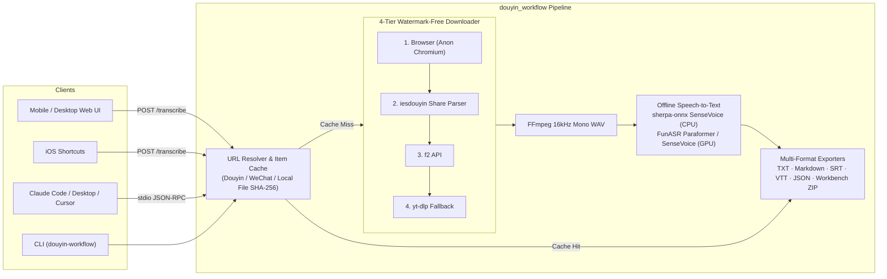

# Douyin Transcript Public (`douyin-transcript-public`)

<p align="center">
  <a href="LICENSE"></a>
  <a href="pyproject.toml"></a>
  <a href="douyin_workflow/mcp_server.py"></a>
  <a href="Dockerfile"></a>
  <a href="README.md"></a>
</p>

<p align="center">
  <b>Self-Hosted Douyin / WeChat Channels / Local Video Speech-to-Text, Watermark-Free Downloader & MCP Server</b><br>
  4-Tier Fallback Downloader (Chromium → iesdouyin → f2 → yt-dlp) · Offline SenseVoice / FunASR ASR · Multi-Format Export (TXT / Markdown / SRT / VTT / JSON) · Mobile Web Workbench
</p>

<p align="center">
  <a href="README.md">简体中文</a> | <b>English</b>
</p>

---

`douyin-transcript-public` is a self-hosted short-video transcription and watermark-free media extraction service designed for reliability, privacy, and seamless LLM integration. Paste a Douyin share string, a WeChat Channels link, or a local video/audio file path to extract clean transcripts in **TXT, Markdown (with YAML frontmatter), SRT, WebVTT, JSON**, or a **Creator Workbench ZIP bundle** with SHA-256 integrity manifests.

## Highlights

- **4-Tier Resilient Downloader Chain**: Automatically falls back across `Anonymous Headless Chromium → iesdouyin share page parser → f2 → yt-dlp` with watermark-free stream selection and multi-CDN retry.
- **Dual Offline ASR Engines**:
  - **Lightweight CPU Mode (`sherpa-sensevoice`)**: Powered by `sherpa-onnx` + quantized SenseVoice int8 (~230 MB, no PyTorch or GPU required), with smart acoustic energy-valley chunking for long videos on low-memory VPS instances.
  - **GPU / High-Accuracy Mode (`SenseVoiceSmall` / `paraformer-zh`)**: Powered by FunASR + FSMN-VAD + CT-Punc.
- **Multi-Format Export (`TXT` / `Markdown` / `SRT` / `VTT` / `JSON`)**:
  - **Markdown (`.md`)**: Includes structured YAML frontmatter (`title`, `author`, `aweme_id`, `duration_s`, `source_url`, `sha256`) and paragraph-grouped transcripts ready for Obsidian, Notion, or RAG pipelines.
  - **Subtitles (`.srt` / `.vtt`)**: Sentence-aligned subtitle cues ready for Premiere, CapCut, Final Cut Pro, or DaVinci Resolve.
  - **Creator Workbench ZIP**: Bundles the source video, proofread transcript, and a `manifest.json` containing SHA-256 hashes and unverified rights metadata.
- **First-Class MCP Server**: Plug directly into **Claude Desktop**, **Claude Code**, or **Cursor** over stdio.
- **Mobile-Ready Web Proofreading UI & iOS Shortcuts API**: Single-page responsive web UI with dark mode, inline proofreading, one-click research prompts, deduplicated polling, and per-item caching.
- **Hardened Production Boundaries**: Per-request cryptographic nonce CSP, `X-Frame-Options: DENY`, 64 KiB body limit, bounded video retention (24h TTL & 2 GiB quota), and Nginx IP rate limiting.

---

## Architecture



---

## Quickstart

### Option 1: Docker Compose (Recommended)

Includes Python 3.12, FFmpeg, headless Chromium, and `sherpa-onnx`:

```bash
git clone https://github.com/ychenfen/douyin-transcript-public.git
cd douyin-transcript-public

# Place SenseVoice int8 model files (model.int8.onnx and tokens.txt) in ./data/models/sensevoice/
mkdir -p data/models/sensevoice data/items data/secrets

# Start the server on http://localhost:8766
docker compose up -d
```

### Option 2: Local Virtualenv / `uv`

Requires Python 3.10+ and `ffmpeg` on `PATH`:

```bash
python3.12 -m venv .venv
# Lightweight CPU installation (sherpa-onnx + SenseVoice int8):
.venv/bin/pip install -e ".[lite,f2,browser,dev]"

# Or full FunASR installation (PyTorch / GPU):
# .venv/bin/pip install -e ".[asr,f2,browser,dev]"
```

Run the web server in passwordless Douyin mode:

```bash
DOUYIN_REQUIRE_AUTH=0 .venv/bin/python -m douyin_workflow serve --host 127.0.0.1 --port 8766
```

---

## MCP Server Setup (Claude & Cursor)

### Claude Code

```bash
claude mcp add douyin -- /path/to/douyin-transcript-public/.venv/bin/python -m douyin_workflow.mcp_server
```

### Claude Desktop / Cursor (`claude_desktop_config.json` / `.cursor/mcp.json`)

```json
{
  "mcpServers": {
    "douyin-transcript": {
      "command": "/path/to/douyin-transcript-public/.venv/bin/python",
      "args": ["-m", "douyin_workflow.mcp_server"],
      "env": {
        "DOUYIN_DATA_DIR": "/Users/yourname/douyin_workflow_data",
        "DOUYIN_ASR_MODEL": "sherpa-sensevoice",
        "DOUYIN_SHERPA_MODEL_DIR": "/Users/yourname/dy2text-public/models/sensevoice",
        "DOUYIN_BACKENDS": "browser,iesdouyin,f2,ytdlp"
      }
    }
  }
}
```

### Available MCP Tools

- `douyin_to_text(share_text, force=False)`: Resolves a Douyin share string/URL, downloads the watermark-free video via the 4-tier fallback chain, transcribes audio, and returns structured metadata + transcript.
- `video_file_to_text(path, title=None, force=False)`: Transcribes any local video/audio file and caches by file content SHA-256.
- `wechat_link_to_text(share_text, force=False)`: Resolves and transcribes a WeChat Channels (`weixin.qq.com/sph/...`) share link using `WECHAT_YUANBAO_COOKIE`.
- `douyin_list_local(limit=20)`: Lists recently transcribed items in the local cache directory.

---

## CLI & HTTP Export Endpoints

### CLI Usage

```bash
# Transcribe a Douyin share link and output Markdown with YAML frontmatter
.venv/bin/python -m douyin_workflow run "7.43 复制打开抖音，看看 https://v.douyin.com/xxxx/" --format md

# Transcribe a local video file and output SRT subtitles
.venv/bin/python -m douyin_workflow file ~/Downloads/demo.mp4 --title "Tech Talk" --format srt

# Export an already-cached item to SRT, VTT, Markdown, JSON, or TXT
.venv/bin/python -m douyin_workflow export 7372484719365098803 --format srt -o subtitle.srt
.venv/bin/python -m douyin_workflow export 7372484719365098803 --format md -o note.md
```

### HTTP Endpoints

- `GET /`: Mobile-friendly Web UI with inline transcript editor and one-click exports
- `GET /health`: Healthcheck endpoint (`{"ok": true}`)
- `POST /transcribe`: Submit share text (`{"text": "..."}`), returns `status: done | running | error`
- `GET /items/<id>/transcript.md`: Download Markdown note with YAML frontmatter
- `GET /items/<id>/transcript.srt`: Download `.srt` subtitles
- `GET /items/<id>/transcript.vtt`: Download `.vtt` WebVTT subtitles
- `GET /items/<id>/transcript.txt`: Download plain-text transcript
- `GET /items/<id>/transcript.json`: Download structured JSON metadata & transcript
- `GET /media/<id>/video`: Download retained source `.mp4` video
- `POST /bundle`: Download Creator Workbench ZIP (`video.mp4` + `transcript.txt` + `manifest.json`)

---

## Testing

```bash
uv run --extra dev pytest
```

## License

[MIT License](LICENSE)
