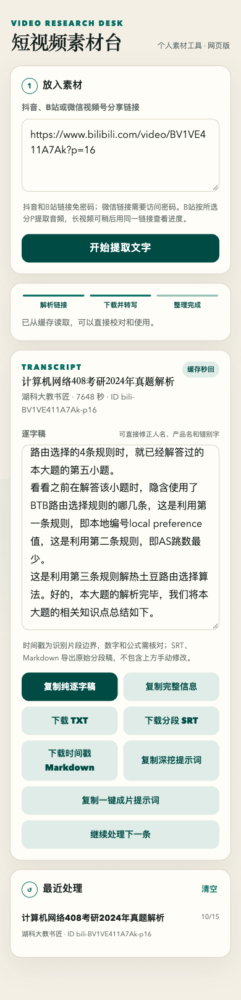

# B站长视频与内存优化验证（2026-10-15）

## 交付边界

B站支持已在本分支实现，经过离线测试、浏览器检查及服务器隔离目录的真实长视频验证。正式网站尚未部署完整 B站功能。

生产两套转写服务仅更新了 `transcribe.py` 和两个内存环境变量，逐个重启并完成健康检查；其他环境配置逐行保留。未修改网络、代理、出口 IP、Nginx 或服务的 1200 MiB 内存上限。

## 自动测试与网页

- `/tmp/bilibili-integration-venv/bin/python -m pytest -q`：104 passed，7.99 秒，安装 numpy 后长音频测试实际执行。
- `git diff --check` 通过。
- 本地网页使用之前真实转写结果作为缓存样本，检查 P16 标题、Markdown/SRT 下载与 309 段内容；此网页检查不代表再次执行完整转写。
- 390 × 844 手机视口检查无横向溢出，控制台无错误；截图见下。



## 真实长视频端到端

在服务器隔离目录 `/home/ubuntu/transcription-jobs/bilibili-integration-20261015` 从链接重新下载音轨并运行完整流水线，没有使用之前的转写缓存。

- 来源：`https://www.bilibili.com/video/BV1VE411A7Ak?p=16`；CID `40343964080`；标题“计算机网络408考研2024年真题解析”。
- WAV 实际时长 7647.468875 秒（127 分 27 秒）；308 段、33837 字符，各段连续且最终边界与 WAV 帧数一致。
- 下载及抽音频 17.4 秒，转写 461.7 秒；首次结果 `cached=false`。
- 再次请求耗时 0.15 秒，返回 `cached=true`；文字、分段和导出内容与第一次一致。
- TXT、Markdown、SRT、segments JSON、元数据均存在；结果未保存签名音轨 URL。
- 本次 308 段为新实现的实测结果；上面的网页 309 段样本来自此前独立转写，两者不是同一次运行。

## 内存实测与生产状态

服务器为约 3.3 GiB RAM、2 GiB swap。测试使用实际 SenseVoice int8 模型和同一段 30 秒 PCM 音频。

| 指标 | RSS |
| --- | ---: |
| Python 初始进程 | 16.1 MiB |
| 首次转写后，保留模型 | 528.0 MiB |
| 主动释放后 | 65.1 MiB |
| 下一次转写后，自动释放 | 65.4 MiB |

两次文字一致（90 字符），自动释放后缓存模型数量为 0。约 463 MiB 的差值是同一个转写进程的实测值，不是整台服务器空闲时的节省量。下一次任务需重新加载模型；首次测试整体耗时 8.19 秒，此值包含加载和推理。

复测命令（需 Linux、实际模型与 WAV）：

```sh
MALLOC_ARENA_MAX=2 DOUYIN_ASR_THREADS=1 \
DOUYIN_SHERPA_MODEL_DIR=/path/to/sensevoice \
PYTHONPATH=. python scripts/benchmark_asr_memory.py /path/to/audio.wav
```

生产已启用 `DOUYIN_RELEASE_ASR_AFTER_JOB=1` 和 `MALLOC_ARENA_MAX=2`。两套服务及公网 `/dy/health` 均返回健康；重启后的服务内存约 20 MiB，机器 memory PSI 三个时间窗口均为 0。历史 swap 占用仍存在，未执行 swapoff 或清缓存。

服务器恢复副本（目录仅服务用户可访问，环境文件权限 0600）：

- `/home/ubuntu/dy2text-public/backups/memory-20261015_081041`
- `/home/ubuntu/dy2text/backups/memory-20261015_081041`

需要回滚时，在服务器上针对目标服务执行（`service_name` 取 `dy2text-public` 或 `dy2text`）：

```sh
service_name=dy2text-public
service_root=/home/ubuntu/$service_name
backup_dir=$service_root/backups/memory-20261015_081041
cp -p "$backup_dir/transcribe.py" "$service_root/app/douyin_workflow/transcribe.py"
cp -p "$backup_dir/dy2text.env" "$service_root/dy2text.env"
sudo systemctl restart "$service_name.service"
# public 使用 8766；legacy 使用 8765。
curl --fail http://127.0.0.1:8766/health
```

## 已知限制

转写稿未经人工逐字校对；时间戳是约 20–30 秒的识别片段边界，未提取视频画面文字或公式。仅支持公开完整音轨，长视频缓存会持续占用磁盘。整套 B站功能仍需合并与正式部署后才会出现在公网网页。
